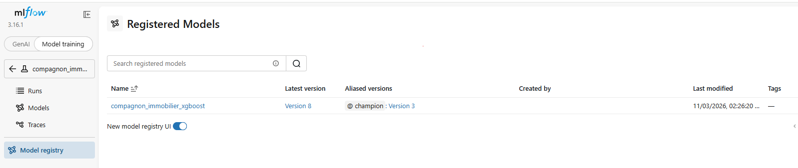

# MLOps – Compagnon Immobilier
==========================================================================================

## Présentation du projet

Ce projet a pour objectif d'**industrialiser un modèle de Machine Learning dédié à l'estimation des prix immobiliers**, en mettant en place une architecture MLOps complète, de la collecte des données jusqu'au déploiement et au suivi du modèle.

Il repose sur plusieurs étapes : la collecte et le prétraitement des données immobilières, leur stockage dans PostgreSQL, l'entraînement et l'évaluation d'un modèle de régression, ainsi que le suivi des expériences et la gestion des versions avec MLflow.

L'application est organisée en **Docker Compose, avec PostgreSQL, MLflow, MinIO, des API FastAPI** dédiées à l'entraînement et à la prédiction, sécurisées par **OAuth2/JWT**, et une interface **Streamlit** permettant d'effectuer des estimations immobilières.

Le projet intègre également **Airflow** pour automatiser le pipeline de données et les entraînements, **Prometheus et Grafana** pour le monitoring, ainsi que **GitHub Actions** pour l'intégration continue et les tests automatisés.

L'objectif final est de construire une solution **reproductible, automatisée, sécurisée et évolutive**, suivant les bonnes pratiques MLOps.

## Sommaire

1. Objectif et fonctionnalités
2. Architecture technique
3. Données et entraînement
4. Installation et démarrage
5. Utilisation des API et de Streamlit
6. Sécurité des API
7. CI/CD - GitHub Actions
8. Airflow....
9. Monitoring...
10. Organisation du dépôt

## 1. Objectif et fonctionnalités

L'application permet d'estimer le **prix d'un logement dans le département du Rhône** à partir de quatre informations fournies par l'utilisateur : le **code INSEE de la commune**, le **type de logement** (maison ou appartement), la **surface habitable** et le **nombre de pièces**.

L'API complète automatiquement ces informations avec des caractéristiques enregistrées dans PostgreSQL, notamment la géolocalisation, la distance à Lyon et certains indicateurs socio-économiques. Elle transmet ensuite l'ensemble des variables au modèle Champion enregistré dans MLflow.

L'application retourne deux résultats :

- le **prix estimé au m²**, en euros ;
- la **valeur totale estimée**, obtenue en multipliant le prix estimé au m² par la surface habitable.

Le projet permet également de déclencher un nouvel entraînement, d'enregistrer les résultats dans MLflow, de comparer une nouvelle version au modèle Champion et de consulter ses performances dans Streamlit.

## 2. Architecture technique

L'architecture MLOps repose sur plusieurs services Docker indépendants, dédiés au stockage des données, à l'entraînement, à la gestion des modèles et à la prédiction.

Docker Compose facilite leur démarrage et leur communication, tout en assurant la persistance des données grâce aux volumes Docker. Cette organisation rend le projet reproductible, évolutif et facile à maintenir.

### 2.1. Services de l'architecture technique

Le projet repose sur plusieurs services, chacun assurant un rôle spécifique dans le fonctionnement de l'application MLOps.

**Docker Compose :** permet de construire, démarrer et orchestrer les différents services de l'application, tout en gérant les réseaux et les volumes Docker.

**PostgreSQL :** assure le stockage des transactions immobilières et des métadonnées MLflow dans deux bases de données distinctes (localhost:5433).

**MinIO :** permet de stocker les modèles entraînés et les artefacts MLflow dans le bucket mlflow-artifacts. Interface d'administration (http://localhost:9001).

**MLflow :** assure le suivi des expériences, l'enregistrement des métriques, la gestion des versions et la sélection du modèle Champion. Interface de suivi (http://localhost:5000).

**FastAPI – Training :** permet de déclencher l'entraînement du modèle XGBoost, son évaluation et son enregistrement dans MLflow. Interface Swagger (http://localhost:8002/docs).

**FastAPI – Prediction :** permet d'effectuer des estimations immobilières avec le modèle Champion et de consulter ses performances. Interface Swagger (http://localhost:8000/docs).

**Streamlit :** propose une interface utilisateur permettant de réaliser des estimations immobilières et de consulter les métriques du modèle Champion. Application web (http://localhost:8501).

**Airflow :** permettra d'automatiser et d'orchestrer les différentes étapes du pipeline MLOps : collecte, prétraitement, chargement des données, entraînement et évaluation du modèle.

**Prometheus / Grafana :** permettront de collecter, surveiller et visualiser les métriques de fonctionnement des services afin d'assurer le monitoring de l'application.

**GitHub Actions :** permettra d'automatiser les contrôles de qualité du code et l'exécution des tests lors des modifications du dépôt GitHub.

### 2.2. Chaîne de préparation et d'entraînement
 
### 2.3. Chaîne de prédiction

 

### 2.4. Orchestration et suivi 

- **Airflow** aura pour rôle d'exécuter les tâches du pipeline dans le bon ordre et de faciliter le réentraînement planifié.
- **Prometheus** collectera les métriques techniques exposées par les services instrumentés ; **Grafana** permettra de les visualiser dans des tableaux de bord. La surveillance de la qualité du modèle pourra être complétée par **Evidently**, selon l'intégration finale.
- **GitHub Actions** permettra de lancer le linting et les tests automatiquement.

## 3. Données et entraînement

### 3.1. Sources des données

Le jeu de données repose sur deux sources complémentaires :

- **DVF géolocalisées :** ventes immobilières de maisons et d'appartements dans le Rhône (69).
- **INSEE :** indicateurs démographiques et socio-économiques, notamment le niveau de vie médian et la densité de population.

Le script **run_pipeline.py** exécute successivement : creer_base(); collecter(); pretraiter() puis charger().
Il contrôle l'existence de la base métier, collecte les fichiers, prépare les données et charge le résultat dans PostgreSQL.

Le prétraitement conserve les ventes de maisons et d'appartements, exclut certaines mutations ambiguës, calcule le prix au m², traite les valeurs extrêmes et enrichit les transactions avec les données INSEE. 
À chaque chargement, la table **transactions_immobilieres** est remplacée par le jeu préparé.

### 3.2. Entraînement du modèle
Le modèle utilisé est XGBRegressor, intégré dans un pipeline combinant le prétraitement des données et l'entraînement du modèle.

- **Variable cible :** prix_m2, en €/m².
- **Variables explicatives :** 12 caractéristiques du logement et de son environnement (commune, type de bien, surface, nombre de pièces, géolocalisation, distance à Lyon, etc.).
- **Séparation des données :** 80 % pour l'entraînement et 20 % pour le test, avec stratification selon le type de logement.
- **Recherche d'hyperparamètres :** RandomizedSearchCV avec 20 itérations et une validation croisée à 3 plis.
- **Métriques :** MAE, RMSE et R².

### 3.3. MLflow et modèle Champion

Les expériences sont suivies dans MLflow sous l'expérience **compagnon_immobilier**. Les modèles sont enregistrés dans le registre sous le nom **compagnon_immobilier_xgboost**.

L'API de prédiction utilise l'alias champion, qui permet de sélectionner le modèle retenu sans coder en dur un numéro de version :

Après chaque nouvel entraînement, le script de comparaison réévalue le Champion existant sur le jeu de test du nouvel entraînement et compare les **MAE**. Le Champion n'est remplacé que si la nouvelle version est meilleure sur ce critère. 
Les métriques affichées dans Streamlit sont récupérées depuis MLflow.

## 4. Installation et démarrage

### 4.1. Configurer les variables d'environnement

Le fichier .env situé à la racine du dépôt. Il contient les paramètres de connexion **PostgreSQL**, les identifiants **MinIO**, la clé secrète **JWT** ainsi que les hachages des mots de passe des comptes admin et user.
Les mots de passe sont hachés avec Argon2. 

### 4.2. Préparer PostgreSQL et MinIO
 
### 4.3. Construire et démarrer l'application

 

## 5. Utilisation des API et de Streamlit

## 5.1. API FastAPI
 
### 5.2. Interface Streamlit
 
## 6. Sécurité des API

 

## 7. CI/CD — GitHub Actions

### 7.1. ci.yml (Intégration continue)

 
### 7.2. release.yml (Livraison: Master)

### 7.3. Tests unitaires

## 8. Airflow....

## 9. Monitoring...

## 10. Organisation du dépôt

jul26_mlops_compagnon_immo/
├── docker-compose.yml                # Services et réseau Docker
├── Dockerfile.api                    # Image des deux API FastAPI
├── Dockerfile.mlflow                 # Image du serveur MLflow
├── requirements.txt                 # Dépendances Python
├── run_pipeline.py                   # Collecte, préparation et chargement
├── streamlit/
│   ├── app.py                        # Interface utilisateur
│   └── Dockerfile
├── src/
│   ├── api/
│   │   ├── securite.py               # Authentification OAuth2/JWT
│   │   ├── training_api.py           # API d'entraînement
│   │   └── prediction_api.py         # API de prédiction
│   ├── data/
│   │   ├── collecte.py               # Collecte DVF/INSEE
│   │   ├── pretraitement.py          # Nettoyage et enrichissement
│   │   └── load_database.py          # Création et chargement PostgreSQL
│   ├── features/
│   │   └── build_features.py         # Préparation des variables
│   └── models/
│       ├── training.py               # Entraînement et suivi MLflow
│       ├── comparer_model.py         # Comparaison et alias Champion
│       └── predict.py                # Inférence avec le Champion
├── .github/workflows/                # Workflows à conserver dans le dépôt final
│   ├── ci.yml                        # Lint, tests et builds
│   └── release.yml                   # Publication des images Docker
├── tests/                            # Tests unitaires à intégrer au dépôt final
├── reports/figures/                      # Schémas du projet
└── README.md
