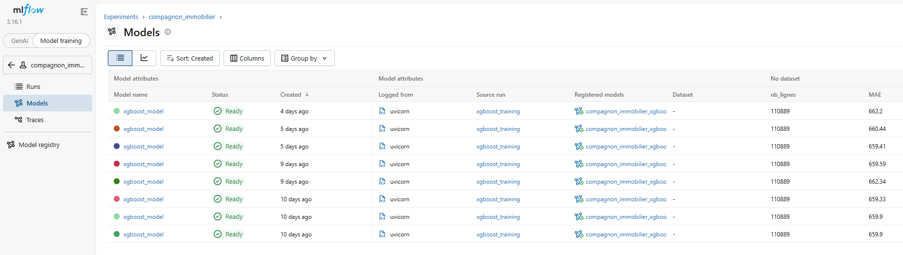
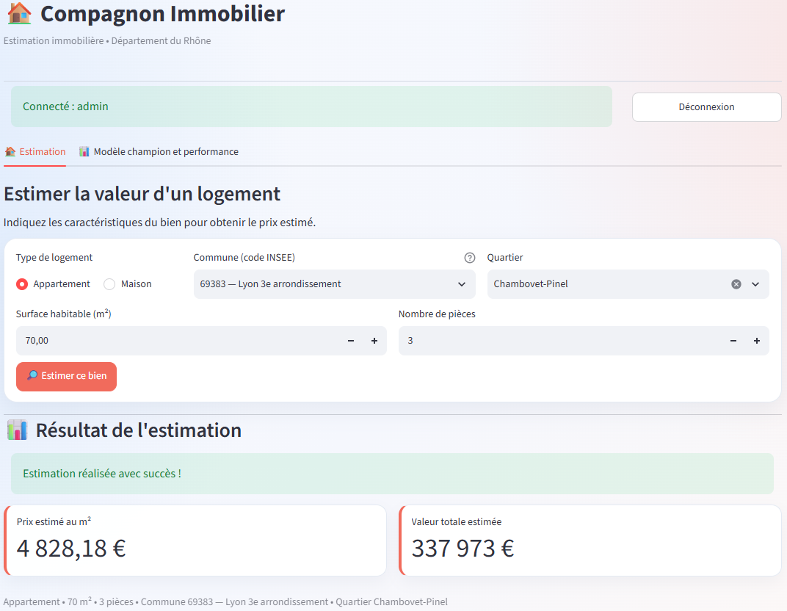
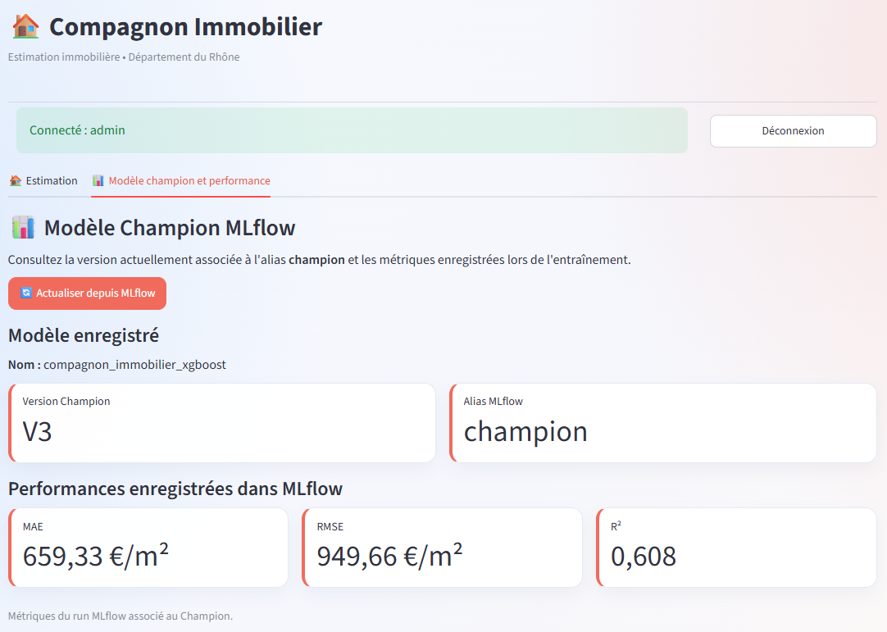
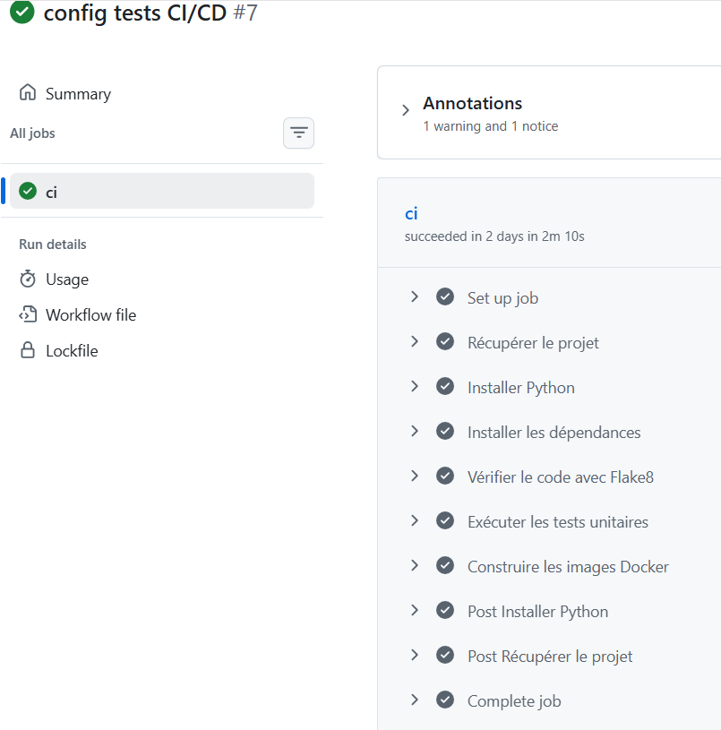

# MLOps – Compagnon Immobilier
==========================================================================================

## Présentation du projet

Ce projet a pour objectif d'**industrialiser un modèle de Machine Learning dédié à l'estimation des prix immobiliers**, en mettant en place une architecture MLOps complète, de la collecte des données jusqu'au déploiement et au suivi du modèle.

Il repose sur plusieurs étapes : la collecte et le prétraitement des données immobilières, leur stockage dans PostgreSQL, l'entraînement et l'évaluation d'un modèle de régression, ainsi que le suivi des expériences et la gestion des versions avec MLflow.

L'application est organisée en **Docker Compose, avec PostgreSQL, MLflow, MinIO, des API FastAPI** dédiées à l'entraînement et à la prédiction, sécurisées par **OAuth2/JWT**, et une interface **Streamlit** permettant d'effectuer des estimations immobilières.

Le projet intègre également **Airflow** pour automatiser le pipeline de données et les entraînements, **Prometheus et Grafana** pour le monitoring, ainsi que **GitHub Actions** pour l'intégration continue et les tests automatisés.

L'objectif final est de construire une solution **reproductible, automatisée, sécurisée et évolutive**, suivant les bonnes pratiques MLOps.

## Sommaire

1. Objectif et fonctionnalités
2. Architecture technique
3. Données et entraînement
4. Installation et démarrage
5. Utilisation des API et de Streamlit
6. Sécurité des API
7. CI/CD - GitHub Actions
8. Airflow....
9. Monitoring...
10. Organisation du dépôt

## 1. Objectif et fonctionnalités

L'application permet d'estimer le **prix d'un logement dans le département du Rhône** à partir de quatre informations fournies par l'utilisateur : le **code INSEE de la commune**, le **type de logement** (maison ou appartement), la **surface habitable** et le **nombre de pièces**.

L'API complète automatiquement ces informations avec des caractéristiques enregistrées dans PostgreSQL, notamment la géolocalisation, la distance à Lyon et certains indicateurs socio-économiques. Elle transmet ensuite l'ensemble des variables au modèle Champion enregistré dans MLflow.

L'application retourne deux résultats :

- le **prix estimé au m²**, en euros ;
- la **valeur totale estimée**, obtenue en multipliant le prix estimé au m² par la surface habitable.

Le projet permet également de déclencher un nouvel entraînement, d'enregistrer les résultats dans MLflow, de comparer une nouvelle version au modèle Champion et de consulter ses performances dans Streamlit.

## 2. Architecture technique

L'architecture MLOps repose sur plusieurs services Docker indépendants, dédiés au stockage des données, à l'entraînement, à la gestion des modèles et à la prédiction.

Docker Compose facilite leur démarrage et leur communication, tout en assurant la persistance des données grâce aux volumes Docker. Cette organisation rend le projet reproductible, évolutif et facile à maintenir.

### 2.1. Services de l'architecture technique

Le projet repose sur plusieurs services, chacun assurant un rôle spécifique dans le fonctionnement de l'application MLOps.

**Docker Compose :** permet de construire, démarrer et orchestrer les différents services de l'application, tout en gérant les réseaux et les volumes Docker.

**PostgreSQL :** assure le stockage des transactions immobilières et des métadonnées MLflow dans deux bases de données distinctes (localhost:5433).

**MinIO :** permet de stocker les modèles entraînés et les artefacts MLflow dans le bucket mlflow-artifacts. Interface d'administration (http://localhost:9001).

**MLflow :** assure le suivi des expériences, l'enregistrement des métriques, la gestion des versions et la sélection du modèle Champion. Interface de suivi (http://localhost:5000).

**FastAPI – Training :** permet de déclencher l'entraînement du modèle XGBoost, son évaluation et son enregistrement dans MLflow. Interface Swagger (http://localhost:8002/docs).

**FastAPI – Prediction :** permet d'effectuer des estimations immobilières avec le modèle Champion et de consulter ses performances. Interface Swagger (http://localhost:8000/docs).

**Streamlit :** propose une interface utilisateur permettant de réaliser des estimations immobilières et de consulter les métriques du modèle Champion. Application web (http://localhost:8501).

**Airflow :** permettra d'automatiser et d'orchestrer les différentes étapes du pipeline MLOps : collecte, prétraitement, chargement des données, entraînement et évaluation du modèle.

**Prometheus / Grafana :** permettront de collecter, surveiller et visualiser les métriques de fonctionnement des services afin d'assurer le monitoring de l'application.

**GitHub Actions :** permettra d'automatiser les contrôles de qualité du code et l'exécution des tests lors des modifications du dépôt GitHub.

### 2.2. Chaîne de préparation et d'entraînement
1. **Collecte :** récupération des transactions DVF et des indicateurs INSEE.
2. **Prétraitement :** nettoyage des ventes, calcul du prix au m², gestion des valeurs extrêmes et enrichissement territorial.
3. **Stockage :** chargement des données préparées dans "immobilier.transactions_immobilieres".
4. **Entraînement :** lecture des données PostgreSQL et entraînement d'un modèle XGBoost.
5. **Suivi MLflow :** enregistrement des hyperparamètres, métriques et fichiers du nouveau modèle.
6. **Sélection :** comparaison de la nouvelle version au Champion existant ; promotion automatique si la nouvelle **MAE** est meilleure sur le jeu d'évaluation utilisé pour la comparaison.

**Airflow** est destiné à automatiser cet enchaînement en réutilisant les fonctions Python existantes. **Docker Compose** prépare les services ; **Airflow** coordonne les traitements : leurs rôles sont complémentaires.

### 2.3. Chaîne de prédiction

Le parcours d'une estimation est distinct de celui de l'entraînement :

1. L'utilisateur se connecte à **Streamlit** et renseigne les caractéristiques d'un logement.
2. Streamlit appelle l'**API de prédiction FastAPI** en transmettant le jeton JWT.
3. L'API récupère dans **PostgreSQL** les caractéristiques complémentaires associées à la commune et au type de logement.
4. L'API charge depuis **MLflow** la version portant l'alias **champion**.
5. Le modèle calcule le **prix estimé au m²** et la **valeur totale estimée**, qui sont renvoyés à Streamlit.

Cette séparation permet d'effectuer des prédictions sans réentraîner le modèle à chaque demande. L'interface utilisateur communique directement avec l'API de prédiction, sans accéder à PostgreSQL ni à MLflow.
Les utilisateurs autorisés peuvent également consulter la version et les performances du modèle Champion (MAE, RMSE et R²) via l'endpoint 
/model-info.

### 2.4. Orchestration et suivi 

- **Airflow** aura pour rôle d'exécuter les tâches du pipeline dans le bon ordre et de faciliter le réentraînement planifié.
- **Prometheus** collectera les métriques techniques exposées par les services instrumentés ; **Grafana** permettra de les visualiser dans des tableaux de bord. La surveillance de la qualité du modèle pourra être complétée par **Evidently**, selon l'intégration finale.
- **GitHub Actions** permettra de lancer le linting et les tests automatiquement.

## 3. Données et entraînement

### 3.1. Sources des données

Le jeu de données repose sur deux sources complémentaires :

- **DVF géolocalisées :** ventes immobilières de maisons et d'appartements dans le Rhône (69).
- **INSEE :** indicateurs démographiques et socio-économiques, notamment le niveau de vie médian et la densité de population.

Le script **run_pipeline.py** exécute successivement : creer_base(); collecter(); pretraiter() puis charger().
Il contrôle l'existence de la base métier, collecte les fichiers, prépare les données et charge le résultat dans PostgreSQL.

Le prétraitement conserve les ventes de maisons et d'appartements, exclut certaines mutations ambiguës, calcule le prix au m², traite les valeurs extrêmes et enrichit les transactions avec les données INSEE. 
À chaque chargement, la table **transactions_immobilieres** est remplacée par le jeu préparé.

### 3.2. Entraînement du modèle
Le modèle utilisé est XGBRegressor, intégré dans un pipeline combinant le prétraitement des données et l'entraînement du modèle.

- **Variable cible :** prix_m2, en €/m².
- **Variables explicatives :** 12 caractéristiques du logement et de son environnement (commune, type de bien, surface, nombre de pièces, géolocalisation, distance à Lyon, etc.).
- **Séparation des données :** 80 % pour l'entraînement et 20 % pour le test, avec stratification selon le type de logement.
- **Recherche d'hyperparamètres :** RandomizedSearchCV avec 20 itérations et une validation croisée à 3 plis.
- **Métriques :** MAE, RMSE et R².

### 3.3. MLflow et modèle Champion

Les expériences sont suivies dans MLflow sous l'expérience **compagnon_immobilier**. Les modèles sont enregistrés dans le registre sous le nom **compagnon_immobilier_xgboost**.

L'API de prédiction utilise l'alias champion, qui permet de sélectionner le modèle retenu sans coder en dur un numéro de version :

Après chaque nouvel entraînement, le script de comparaison réévalue le Champion existant sur le jeu de test du nouvel entraînement et compare les **MAE**. Le Champion n'est remplacé que si la nouvelle version est meilleure sur ce critère. 
Les métriques affichées dans Streamlit sont récupérées depuis MLflow.

## 4. Installation et démarrage

### 4.1. Configurer les variables d'environnement

Le fichier .env situé à la racine du dépôt. Il contient les paramètres de connexion **PostgreSQL**, les identifiants **MinIO**, la clé secrète **JWT** ainsi que les hachages des mots de passe des comptes admin et user.
Les mots de passe sont hachés avec Argon2. 

### 4.2. Préparer PostgreSQL et MinIO

Pour assurer le fonctionnement de MLflow, nous avons configuré deux espaces de stockage :

  - PostgreSQL : la base mlflow_metadata, utilisée pour stocker les informations sur les expériences, les métriques et les versions des modèles.

  - MinIO : le bucket mlflow-artifacts, destiné au stockage des modèles entraînés et de leurs artefacts.

Ces ressources ont été créées lors de la configuration initiale du projet. Elles sont conservées grâce aux volumes persistants Docker, même après l'arrêt ou le redémarrage des conteneurs.

Démarrer PostgreSQL et MinIO :
  - docker compose up -d postgres minio

Vérifier les bases PostgreSQL existantes :
  - docker compose exec postgres sh -c 'psql -U "$POSTGRES_USER" -d postgres -l'

Le bucket mlflow-artifacts peut être consulté depuis la console MinIO : http://localhost:9001.

Lors d'une première installation sur un nouvel environnement, la base mlflow_metadata et le bucket mlflow-artifacts doivent être créés s'ils n'existent pas déjà. Les volumes Docker permettent ensuite de conserver les données et les modèles enregistrés.

### 4.3. Construire et démarrer l'application

Les commandes suivantes permettent de vérifier la configuration, de construire les images Docker, de démarrer les conteneurs et de contrôler leur état :

docker compose config
docker compose up -d --build
docker compose ps

## 5. Utilisation des API et de Streamlit

## 5.1. API FastAPI

Le projet dispose de deux API FastAPI distinctes afin de séparer les fonctionnalités d'entraînement et de prédiction immobilière.

- API d'entraînement (port 8002) : permet de lancer l'entraînement du modèle XGBoost, d'évaluer ses performances et de gérer son enregistrement dans MLflow.

- API de prédiction (port 8000) : permet d'estimer le prix d'un logement à partir de ses caractéristiques et de consulter les informations du modèle Champion enregistré dans MLflow.

Les deux API sont sécurisées par une authentification OAuth2 avec des tokens JWT, permettant de contrôler l'accès aux fonctionnalités selon le rôle de l'utilisateur.

- Les endpoints /health permettent de vérifier que les deux API sont accessibles et fonctionnent correctement:
    curl http://localhost:8002/health
    curl http://localhost:8000/health

- Exemple de prédiction immobilière

  L'API de prédiction reçoit les caractéristiques principales d'un logement :
  {
    "code_commune": "69383",
    "type_local": "Appartement",
    "surface_reelle_bati": 70,
    "nombre_pieces_principales": 3
  }

À partir de ces informations, l'API :
    -   Récupère les caractéristiques complémentaires du logement et de son environnement dans PostgreSQL.
    -   Charge le modèle Champion enregistré dans MLflow.
    -   Effectue la prédiction à l'aide du modèle XGBoost.
    -   Retourne le prix estimé au m² et la valeur totale estimée du logement.

### 5.2. Interface Streamlit

L'application est accessible depuis **http://localhost:8501** et propose deux onglets :

**Estimation** : Saisie des caractéristiques du logement et affichage du prix au m² et de la valeur totale estimée.

**Modèle Champion et performance** : Consultation de la version du modèle retenu et de ses métriques MAE, RMSE et R² via le point
 GET/model-info.
 

Après authentification, **Streamlit communique avec l'API de prédiction FastAPI** pour effectuer les estimations immobilières et consulter les performances du modèle Champion. L'API récupère les données complémentaires dans PostgreSQL et utilise le modèle Champion enregistré dans MLflow. Cette séparation simplifie la maintenance et l'évolution des services.

## 6. Sécurité des API

Les API sont sécurisées grâce à une authentification OAuth2 par token JWT et à une gestion des droits selon le rôle de l'utilisateur.
Les mots de passe sont vérifiés à partir de hachages Argon2 fournis par variables d'environnement.
Deux rôles sont définis :

- **admin :** autorisé à déclencher un entraînement et à effectuer des prédictions ;
- **user :** autorisé à effectuer des prédictions immobilières.

Les endpoints protégés peuvent renvoyer deux codes d'erreur 401 et 403:

401 (Non autorisé) : le token absent, invalide ou expiré.
403 (Accès interdit) : l'utilisateur authentifié, mais sans droit pour l'opération demandée.

## 7. CI/CD — GitHub Actions

La **CI/CD** vise à contrôler automatiquement la qualité du code et à faciliter la construction et la livraison des images Docker. Les workflows prévus sont placés dans **.github/workflows/**.

### 7.1. ci.yml (Intégration continue)

Ce workflow est conçu pour se déclencher lors des **pushs et pull requests** :

1. **Flake8 :** vérifie la syntaxe du code Python et détecte certaines erreurs de programmation ;
2. **Pytest :** exécution des tests unitaires ;
3. **Docker Build :** vérification de la construction des images de l'API, de MLflow et de Streamlit.

### 7.2. release.yml (Livraison: Master)

Ce workflow est prévu **uniquement après un push sur master**. Il reprend les contrôles **Flake8** et **Pytest**, puis construit et publie les images Docker sur **DockerHub**, à l'aide des identifiants configurés dans les secrets GitHub.

La publication sur DockerHub rend les images disponibles dans un registre, ce qui permet de centraliser les images Docker et de faciliter leur réutilisation et leur déploiement.

### 7.3. Tests unitaires

Des tests automatisés ont été mis en place avec **Pytest** afin de vérifier le bon fonctionnement de certaines fonctionnalités essentielles du projet, notamment la validation des données, la sécurité des API et la sélection du modèle Champion dans MLflow.

Les tests suivants ont été réalisés:

| Test                            | Vérification 
----------------------------------------------------------------------------------------------------------------------------------
| Surface invalide                | Vérifie qu'une surface négative ou nulle est refusée. 
| Nombre de pièces invalide       | Vérifie qu'un logement avec 0 pièce est refusé.
| API Health                      | Vérifie que l'API répond correctement.
| Prédiction sans token           | Vérifie qu'une requête sans authentification est refusée avec une erreur HTTP 401. 
| Sélection du Champion           | Vérifie qu'un premier modèle peut recevoir l'alias champion dans MLflow. 

Ces contrôles sont intégrés au pipeline **GitHub Actions** afin d'automatiser les vérifications lors des modifications du code.
Cette mise en place permet de détecter rapidement les erreurs, de fiabiliser les fonctionnalités principales et de faciliter la maintenance du projet.

## 8. Airflow....

## 9. Monitoring...

## 10. Organisation du dépôt

jul26_mlops_compagnon_immo/
├── docker-compose.yml                # Services et réseau Docker
├── Dockerfile.api                    # Image des deux API FastAPI
├── Dockerfile.mlflow                 # Image du serveur MLflow
├── requirements.txt                 # Dépendances Python
├── run_pipeline.py                   # Collecte, préparation et chargement
├── streamlit/
│   ├── app.py                        # Interface utilisateur
│   └── Dockerfile
├── src/
│   ├── api/
│   │   ├── securite.py               # Authentification OAuth2/JWT
│   │   ├── training_api.py           # API d'entraînement
│   │   └── prediction_api.py         # API de prédiction
│   ├── data/
│   │   ├── collecte.py               # Collecte DVF/INSEE
│   │   ├── pretraitement.py          # Nettoyage et enrichissement
│   │   └── load_database.py          # Création et chargement PostgreSQL
│   ├── features/
│   │   └── build_features.py         # Préparation des variables
│   └── models/
│       ├── training.py               # Entraînement et suivi MLflow
│       ├── comparer_model.py         # Comparaison et alias Champion
│       └── predict.py                # Inférence avec le Champion
├── .github/workflows/                # Workflows à conserver dans le dépôt final
│   ├── ci.yml                        # Lint, tests et builds
│   └── release.yml                   # Lint, tests et builds et Publication des images Docker
├── tests/                            # Tests unitaires à intégrer au dépôt final
├── reports/figures/                  # Images/ Schémas du projet
└── README.md
